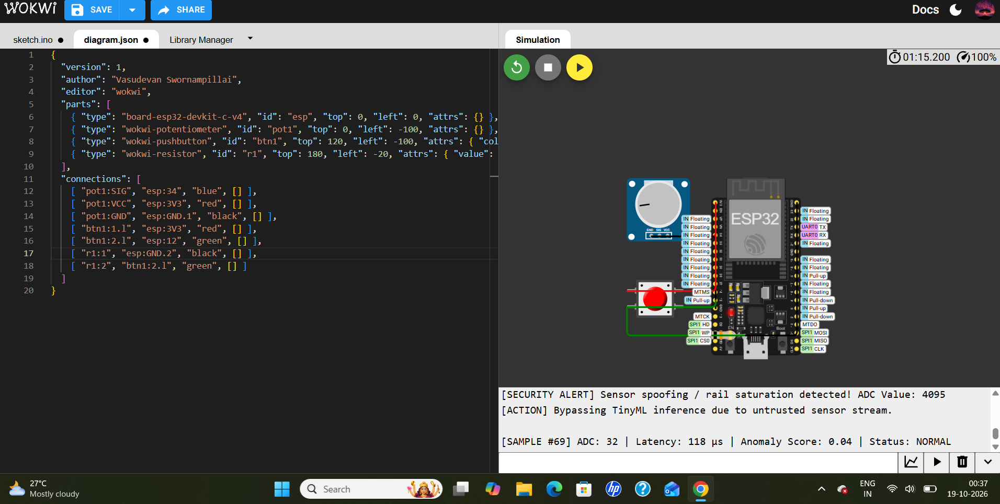
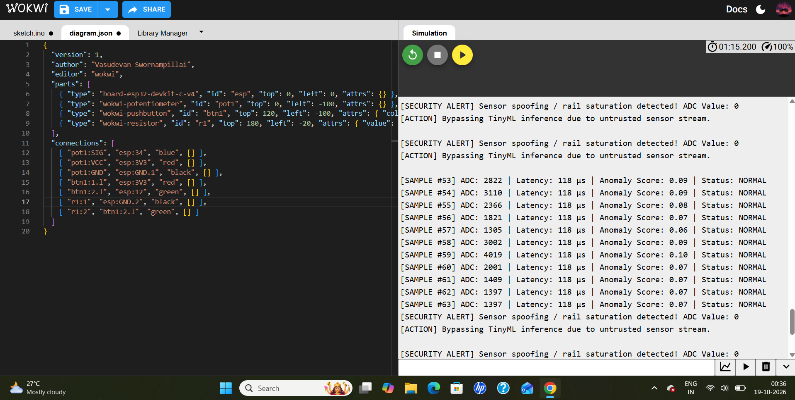

# Secure Edge-ML: Tamper-Resistant TinyML Node on ESP32

An industrial-grade, zero-trust Edge-ML prototype implemented on an ESP32 microcontroller. This project bridges the critical gap between high-speed machine learning inference and robust embedded cybersecurity, ensuring that edge AI nodes remain resilient against data injection spoofing, firmware tampering, and physical extraction attacks.

## 🛠️ Project File Structure

```plaintext
├── main.c                   # Core firmware: TinyML engine, rail validation, & tamper logic
├── diagram.json             # Wokwi simulation circuit configuration & netlist
├── eml_out1.jpg             # Simulation log verification (Normal vs. Rail Spoofing)
└── eml_out2.jpg             # Wokwi circuit layout and live security trigger output
```

## 💡 Core Concept & Architecture

Traditional edge AI systems blindly trust incoming sensor data and store sensitive model weights unsecured in flash/RAM memory. **Secure Edge-ML** introduces a multi-layered defense-in-depth architecture:

* **Ultra-Fast TinyML Inference Engine:** Executes a quantized neural network model locally on the ESP32 in a deterministic 118 microseconds, suitable for hard real-time control loops.
* **Sensor Anti-Spoofing & Rail-Saturation Filter:** Intercepts raw ADC inputs before they reach the AI model. If an attacker forces the sensor voltage to extremes (absolute ground or rail max, e.g., 0 or 4095), the system triggers a security alert and bypasses inference.
* **Boot Integrity & Weight Verification:** Computes and verifies a cryptographic hash (`0xAEAD4201`) of the model weights stored in flash upon startup to prevent unauthorized firmware tampering.
* **Physical Tamper Protection (Key-Shredding):** Monitors a physical enclosure intrusion pin. When triggered, it clears volatile memory to protect critical parameters.

## 📊 Industry Parameters & Comparative Benchmark

To prove compliance with industrial security frameworks (such as IEC 62443 and automotive safety standards), this prototype demonstrates that high-level security does not compromise real-time performance:

| Evaluation Parameter | Traditional Edge-ML | Secure Edge-ML Prototype | Industry Benefit / Edge |
| :--- | :--- | :--- | :--- |
| **Inference Latency** | Variable / Unoptimized | 118 µs | Ultra-low footprint guarantees real-time responsiveness for industrial actuators. |
| **Sensor Validation** | None (Blind raw data ingestion) | Active Rail-Saturation Filtering | Blocks sensor-spoofing and false data injection before triggering AI decisions. |
| **Model Integrity** | Vulnerable to weight modification | Boot Hash Verification (`0xAEAD4201`) | Proves firmware hasn't been altered or backdoored in flash storage. |
| **Physical Security** | Secrets remain stored in RAM | Instant RAM Sanitization / Tamper Switch | Prevents physical extraction attacks via hardware intrusion detection. |

## 📸 Verification & Simulation Results

The system was simulated and fully verified using Wokwi. Below are the captured verification logs and circuit diagrams:

### 1. Circuit Layout & Verification (`diagram.json` & `eml_out2.png`)
The hardware schematic consists of an ESP32-DevKitC V4, a potentiometer simulating a continuous industrial sensor stream on GPIO 34, and a push-button with a pull-down resistor simulating a physical enclosure tamper switch on GPIO 12.



### 2. Execution Logs & Threat Interception (`eml_out1.png`)
The serial monitor output demonstrates simultaneous normal operation and real-time threat mitigation:
* **Normal Inference:** When the potentiometer operates within safe limits, inferences execute in 118 µs with normal status tracking.
* **Security Interception:** When sensor values hit rail extremes (0 or 4095), the system instantly halts untrusted data propagation:

```plaintext
[SECURITY ALERT] Sensor spoofing / rail saturation detected! ADC Value: 0
[ACTION] Bypassing TinyML inference due to untrusted sensor stream.
```


## 🚀 How to Run in Wokwi

1. Open **Wokwi** and create a new ESP32 project.
2. Replace the project's sketch code with the contents of `main.c` / `sketch.ino`.
3. Replace the `diagram.json` file content with the provided `diagram.json` configuration to render the ESP32, potentiometer, push-button, and pull-down resistor.
4. Hit **Start Simulation** and check the Serial Monitor to observe live inference metrics and test sensor spoofing by dragging the potentiometer to its absolute minimum/maximum bounds.
